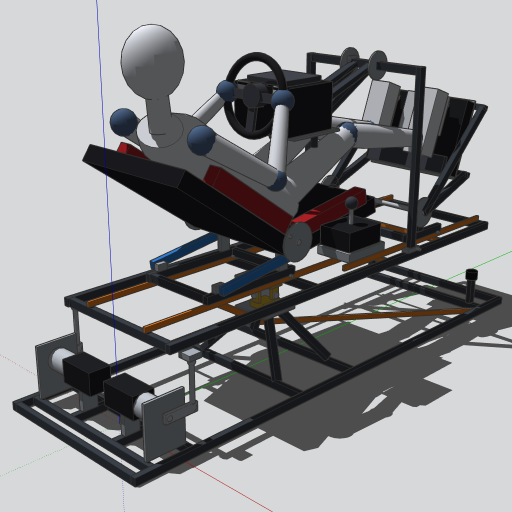
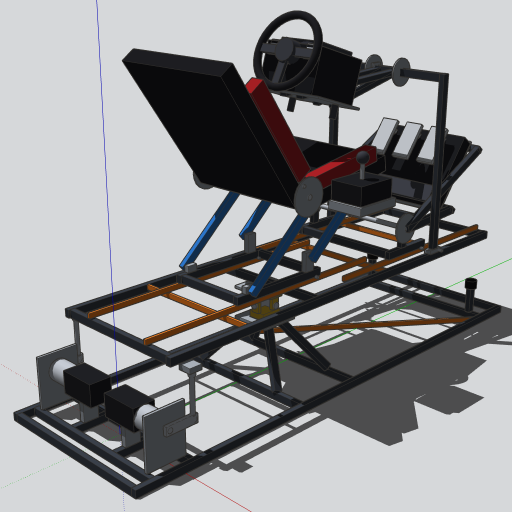
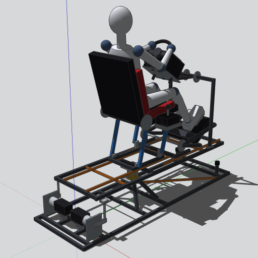

# cockpit-2dof

Cockpit de simulador para jogos de computador, com **plataforma móvel de 2
graus de liberdade** (arfagem e rolagem). Ele passa da posição **Fórmula 1**
para a de **caminhão** só por articulações, trilhos e travas, na mesma
estrutura. Dimensionado para uma pessoa de **170 a 175 cm** e para os
periféricos **Logitech G920** (volante e pedais) e **Driving Force
Shifter**.

| Posição F1 | Transição | Posição caminhão |
|---|---|---|
|  |  |  |

## Conceito

- **Plataforma-base** fixa no piso, sustentando a **plataforma-móvel**.
- União por um **pivô central** (cardan) perto do centro de gravidade e por
  **duas hastes traseiras** com **manivelas acionadas por motores de
  passo**.
- Estrutura em **tubo 20×30** nas regiões de maior esforço e **tubo
  10×20** nas de menor esforço.
- **Mecanismos de ajuste:**
  - banco em quadrilátero articulado com encosto reclinável;
  - pedaleira basculante;
  - volante em braço pivotado.

  Cada um tem seu carro em trilho e trava por pino.
- **Componentes dinâmicos:** clicar na plataforma com a ferramenta
  **Interagir** do SketchUp roda `ANIMATE("modo",0,1)` e anima a troca de
  posição.

Detalhes completos no **[Memorial Descritivo](docs/MEMORIAL-DESCRITIVO.md)**.

> ⚠️ **Status: anteprojeto.** Não houve cálculo estrutural nem
> dimensionamento dos motores, e os componentes dinâmicos ainda não foram
> testados no SketchUp desktop. Leia a seção 12 do memorial antes de
> fabricar.

## Estrutura do repositório

| Caminho | Conteúdo |
|---|---|
| `docs/MEMORIAL-DESCRITIVO.md` | Memorial descritivo (revisão R1) |
| `modelo/gerar_modelo.py` | Gerador paramétrico do modelo SketchUp (v2) |
| `modelo/cockpit_2dof_ajustavel_G920.skp` | Modelo 3D v2 com componentes dinâmicos (enviado manualmente) |
| `modelo/cockpit_simulador_F1_caminhao*.skp` | Modelos da R0 (duas configurações sobrepostas), mantidos como histórico |
| `imagens/` | Prévias do modelo |

## Usando o modelo

1. Abra o `.skp` no **SketchUp desktop**.
2. Selecione a ferramenta **Interagir** e clique na plataforma móvel para
   alternar entre F1 e caminhão.
3. Para escolher a posição sem animar, use **Janela → Opções do
   componente**.
4. Se alguma peça girar para o lado errado, troque **Sentido** para
   **Invertido** nas Opções do componente.

| Cena | Mostra |
|---|---|
| `Vista 3/4` / `Vista Lateral` | Conjunto completo |
| `Mecanismos (sem manequim)` | Mecanismos sem os manequins |
| `Base e Atuadores` | Somente a estrutura fixa, motores, manivelas e hastes |

## Regenerando o modelo

`modelo/gerar_modelo.py` roda no ambiente Python do conector **Trimble
SketchUp MCP**, e não no console Ruby do SketchUp desktop.

1. Envie o conteúdo inteiro do arquivo como `code` de uma chamada
   `build_model` com `clean: true`.
2. Chame `save_model` para obter o `.skp`.

Para mudar uma postura, edite `POSE_F1` / `POSE_TRK`. Os pivôs e cursos
dos mecanismos são recalculados a partir delas. O relatório devolvido pela
execução traz erros de síntese, folgas e cursos para conferência.
