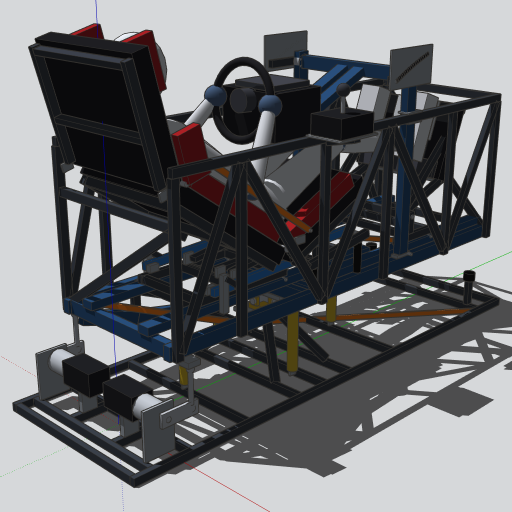
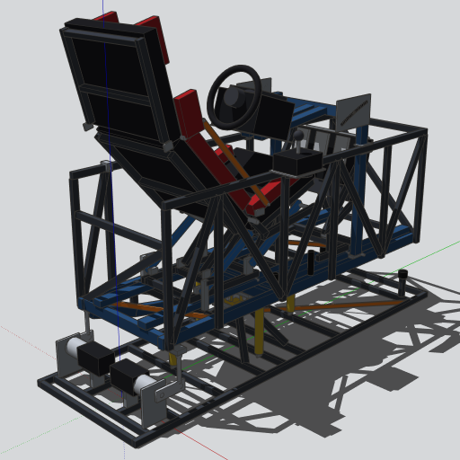
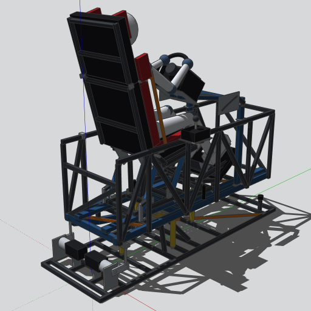
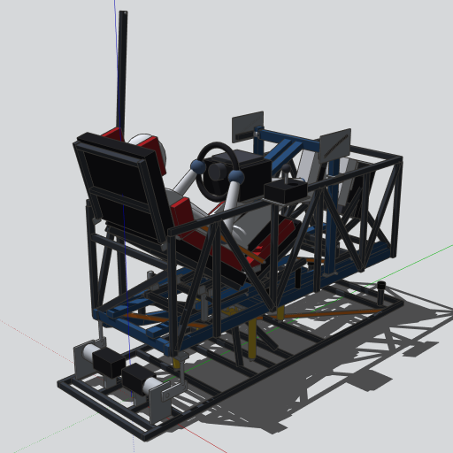

# cockpit-2dof

Cockpit de simulador para jogos de computador, com **plataforma móvel de 2 graus de liberdade** (arfagem e
rolagem). Ele passa da posição **Fórmula 1** para a de **caminhão** só por articulações, trilhos e travas. Cada
módulo (banco, pedaleira, volante) converte em **um único movimento**. Dimensionado para uma pessoa de 170 a
175 cm, para os periféricos **Logitech G920** (volante, pedais e Driving Force Shifter) e para uso com **óculos
de realidade virtual**.

| F1 | Transição | Caminhão | Porta aberta |
|---|---|---|---|
|  |  |  |  |

## Conceito (revisão R3)

- **Plataforma-base** fixa, com cardan no pivô (perto do CG) e duas hastes traseiras acionadas por manivelas de
  motores de passo NEMA 34 com redutor 20:1.
- **Plataforma móvel:**
  - chassi em tubo 30×50;
  - **anel estrutural** treliçado a 930 mm do piso;
  - **barra da porta** removível que abre para cima;
  - treliça de soleira no lado da porta.
- **Mecanismos de 1 movimento:**
  - banco em paralelogramo com tirantes de arrasto, hastes de assento e encosto, e **tirante paralelo** que mantém
    o apoio de ombros/cabeça sempre a 75°;
  - pedaleira basculante por haste;
  - volante em braço pivotado com came;
  - travas por pino rápido.
- **CG balanceado** sobre o pivô nos dois modos.
- **Molas de centragem** de tração como freio econômico.
- **Componentes dinâmicos:**
  - clicar na plataforma com a ferramenta **Interagir** anima a troca F1 ↔ caminhão (`ANIMATE("modo",0,1)`);
  - clicar na barra da porta a abre e fecha (`ANIMATE("aberta",0,1)`).
- **Identificação:** toda peça tem código, por exemplo `M-T01` ou `BC-PI11`. É o mesmo no desenho, na lista de
  materiais e no plano de corte.

> **Status:** anteprojeto R3 **verificado por cálculo e por checagem geométrica automática**, aguardando revisão
> independente e protótipo. Leia a seção 13 do memorial antes de fabricar.

## Documentação

| Documento | Conteúdo |
|---|---|
| [Memorial descritivo](docs/MEMORIAL-DESCRITIVO.md) | Concepção, mecanismos, decisões e pontos em aberto (R3) |
| [Cálculos](docs/CALCULOS.md) | Massas, CG, envoltória, motores, molas, tensões, pinos, verificação geométrica |
| [Lista de materiais](docs/LISTA_DE_MATERIAIS.md) ([CSV](docs/lista_de_materiais.csv)) | Peças codificadas, comprados e itens não desenhados |
| [Plano de corte](docs/PLANO_DE_CORTE.md) ([CSV](docs/plano_de_corte.csv)) | Peças de tubo distribuídas em barras de 6 m |

## Estrutura do repositório

| Caminho | Conteúdo |
|---|---|
| `modelo/gerar_modelo.py` | Gerador paramétrico (geometria, identificação, mecanismos, massas, componentes dinâmicos) |
| `modelo/cockpit_2dof_v3.skp` | Modelo 3D R3 (enviado manualmente — ver abaixo) |
| `modelo/cockpit_simulador_F1_caminhao*.skp` | Modelos da R0, mantidos como histórico |
| `ferramentas/verificar.py` | Verificação de interferências e da envoltória de movimento |
| `ferramentas/analisar.py` | Gera cálculos, lista de materiais, plano de corte e o `PRESET` do gerador |
| `imagens/` | Prévias do modelo (R2 e R3) |

A versão R2 (v2) está preservada no branch `versao-2`.

## Usando o modelo

1. Abra o `.skp` no **SketchUp desktop**.
2. Use a ferramenta **Interagir**:
   - clique na plataforma móvel para alternar entre F1 e caminhão;
   - clique na barra da porta para abri-la.
3. Para escolher o estado sem animar, use **Janela → Opções do componente**.
4. Se alguma peça girar para o lado errado, troque **Sentido** para **Invertido**.

## Regenerando

```bash
python3 ferramentas/verificar.py     # interferências e envoltória (≈ 30 s)
python3 ferramentas/analisar.py      # cálculos, lista de materiais, plano de corte, PRESET
```

Depois envie `modelo/gerar_modelo.py` inteiro como `code` de `build_model` (conector Trimble SketchUp MCP,
`clean: true`) e chame `save_model`. Detalhes na seção 15 do memorial.
